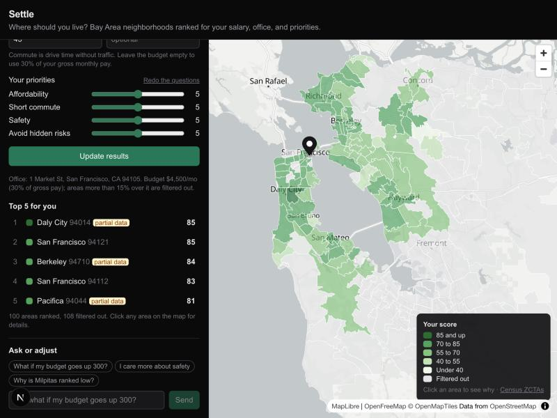
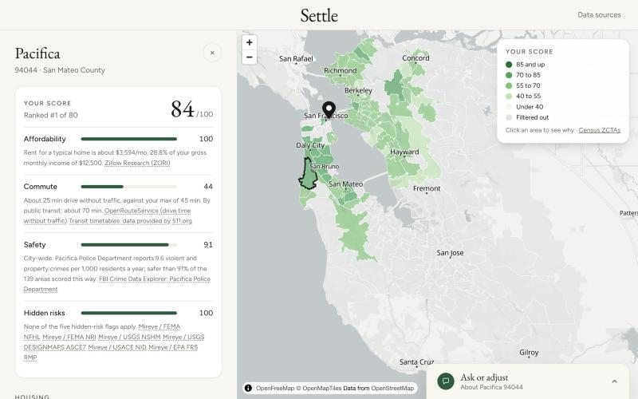
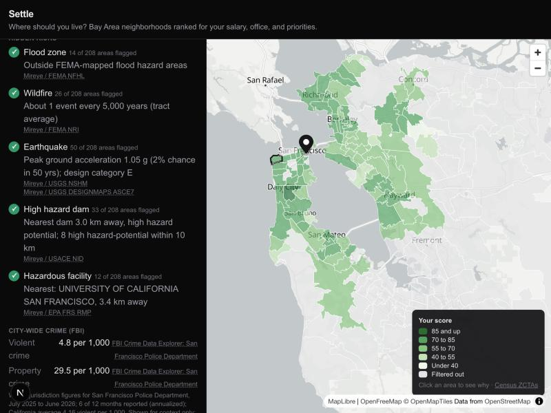
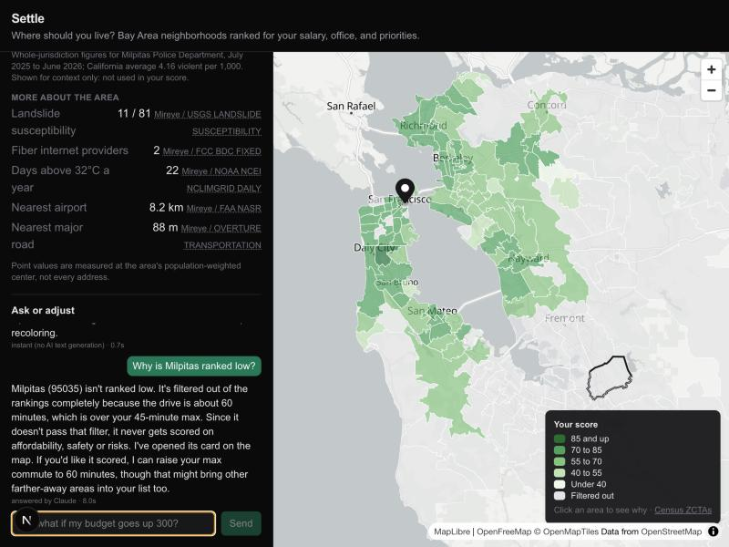
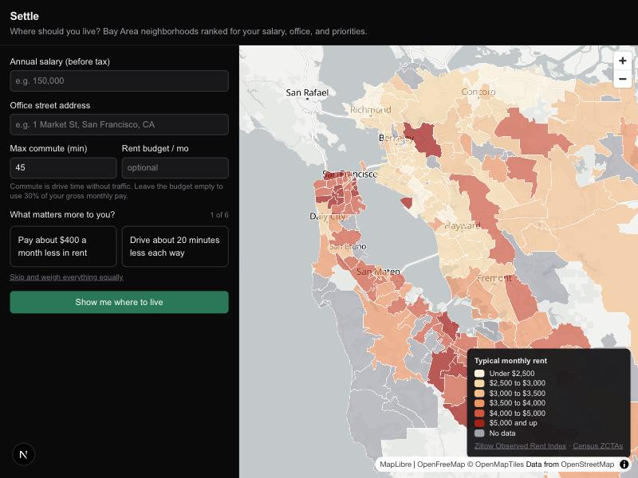
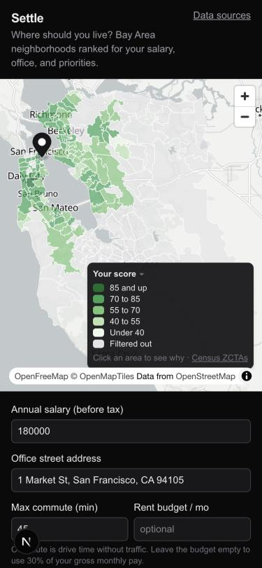
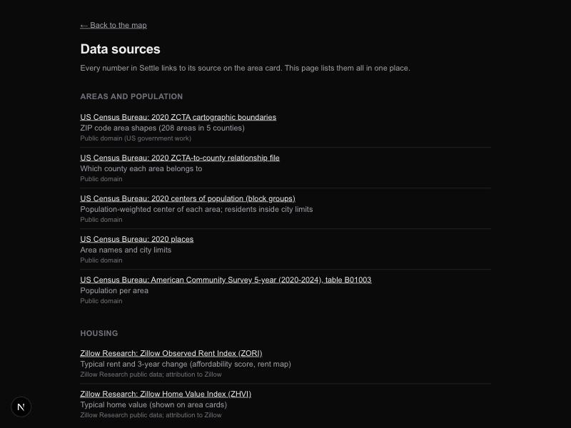

# Settle: where should I live?

Settle answers one question for someone moving to the San Francisco Bay Area: **given my salary, my office, and what I care about, which neighborhoods should I live in?**

You enter a salary, an office address, a maximum commute, the home size you want (a room in a shared home, a studio, or 1-4 bedrooms) and your priorities. Settle ranks the 208 ZIP code areas in San Francisco, San Mateo, Santa Clara, Alameda and Contra Costa counties, colors them on a map, and explains every score with numbers linked to their sources. A chat box handles "what if" questions and updates the map live.



| Score breakdown | Hidden risks and city crime | Chat |
|---|---|---|
|  |  |  |

| Start (rent map) | Phone | Data sources page |
|---|---|---|
|  |  |  |

## How it works

- **Scoring is deterministic** (`lib/scoring/score.ts`, unit tested). Areas over your max commute, or more than 15% over your rent budget, are filtered out. The rest get four sub-scores from 0 to 100:
  - **Affordability:** rent for your home size as a share of income.
  - **Commute:** drive time (no traffic) or typical weekday-morning public-transit time, whichever you choose, against your max.
  - **Safety:** crime rate percentile (neighborhood data in SF, Oakland and San Jose; the city's FBI rate elsewhere, on its own scale).
  - **Hidden risks:** flood, wildfire, earthquake, dam, hazardous facility.

  These are combined with your priority weights. Missing data is never counted as zero: the weights are spread over what's available, and the area is labeled "partial data". Every threshold lives in `lib/scoring/config.ts`.
- **Area data is precomputed** by a Python pipeline (`pipeline/`) into Postgres + PostGIS. At request time the app only geocodes your office, gets commute times, and scores.
- **The chat agent** (`lib/agent/`): [Jev](https://typesafe.ai/) classifies each message. Confident filter, priority and compare requests are applied with deterministic parsing and no LLM call (≈0.2 s). Explanations and anything uncertain go to Claude, which may only state numbers from the app's own results; a numeric grounding check enforces this. Every message is logged to `agent_logs`.

Design decisions, with the reasoning and alternatives for each, are in [`decisions.md`](decisions.md). How the code runs end to end is in [`flow.md`](flow.md).

## Data

All sources, with links and licenses, are listed in the app at `/sources` ([`app/sources/page.tsx`](app/sources/page.tsx)). In short:

- **Areas and population:** US Census 2020 ZCTAs, places, block group centers of population; ACS 5-year 2020–2024.
- **Rent and home values:** Zillow Research (ZORI typical rent, ZHVI); HUD Small Area Fair Market Rents FY2027 for rent by home size (a shared room is estimated as a third of a 3-bedroom).
- **Hidden risks:** FEMA, USGS, USACE, EPA, FCC, NOAA, FAA and Overture data, via the [Mireye](https://api.mireye.com) API.
- **Safety:** police data from San Francisco (DataSF), Oakland and San Jose for Jul 2025 to Jun 2026, classified violent / property / minor by Jev, with Claude re-checking uncertain labels. Elsewhere, FBI Crime Data Explorer city-wide rates provide a labeled "city-wide" safety score.
- **Commute:** openrouteservice drive times (no traffic); public-transit times precomputed with r5py from 511.org regional timetables (data provided by 511.org) and OpenStreetMap. **Basemap:** OpenFreeMap, © OpenStreetMap contributors.

**Caveats:**
- Only San Francisco, Oakland and San Jose publish neighborhood crime data (69 of 208 areas); other areas use a coarser city-wide FBI rate.
- Commute times assume no traffic.
- Risk values are measured at each area's population-weighted center, not at every address.

## Run it locally

Requirements: Node 20+, Python 3.12+ with [uv](https://docs.astral.sh/uv/), Docker.

```bash
cp .env.example .env.local   # then fill in the keys
docker compose up -d         # Postgres 17 + PostGIS on localhost:5433, schema from db/init/
npm install                  # also copies MapLibre's worker into public/maplibre/
uv sync --project pipeline
```

Keys (all in `.env.local`, never committed):

| Variable | Used for | Notes |
|---|---|---|
| `DATABASE_URL` | Postgres | default in `.env.example` matches docker-compose |
| `CENSUS_API_KEY` | ACS population | free |
| `MIREYE_API_TOKEN` | hidden risks, office geocoding | paid credits; the fetch asks for a quote first |
| `ORS_API_KEY` | commute matrix | free tier |
| `FBI_API_KEY` | FBI city crime (cards only) | free api.data.gov key |
| `JEV_API_KEY` | crime classification, chat routing | |
| `ANTHROPIC_API_KEY`, `ANTHROPIC_WORKSPACE_ID` | Claude fallback | workspace ID only if the key isn't workspace-scoped |
| `RENTCAST_API_KEY` | v2 only (listings) | 50 requests/month; unused in v1 |
| `TRANSIT_511_API_KEY` | public-transit timetables (pipeline only) | free at 511.org/open-data/token |

### Build the data (run once, in order)

Each step caches raw downloads and API responses in `data/raw/` (git-ignored), so re-running is free.

```bash
P="uv run --project pipeline python -m settle_pipeline"
$P.fetch_census && $P.load_areas            # 208 areas, population, centroids, names
$P.fetch_zillow && $P.load_zillow           # rent and home values
$P.load_hud                                 # rent by home size (HUD SAFMR FY2027)
$P.fetch_mireye                             # dry run: prints the credit quote
$P.fetch_mireye --confirm && $P.load_mireye # paid: ~2,900 credits
$P.fetch_crime && $P.geocode_sanjose && $P.prepare_crime
$P.classify_crime && $P.aggregate_crime     # Jev (+ Claude for low confidence), then rates
$P.fetch_fbi && $P.load_fbi                 # FBI city-level context
$P.fetch_transit                           # 511 timetables + OSM (needs osmium-tool)
$P.compute_transit && $P.load_transit      # transit times (needs Java 21; several minutes)
```

Then start the app:

```bash
npm run dev    # http://localhost:3000
```

### Tests

```bash
npm test                             # Vitest: scoring, parsers, router, grounding, clients
uv run --project pipeline pytest     # pytest: pipeline transforms and parsers
```

Tests never call paid APIs; network clients are injected or faked.

## Project layout

| Path | What's there |
|---|---|
| `app/` | Next.js pages and API routes (`/api/areas`, `/api/areas/[zcta]`, `/api/score`, `/api/chat`, `/api/health`) |
| `components/` | Map, form, priority cards, top 5, area card, chat |
| `lib/scoring/` | Deterministic scoring, its config, request validation |
| `lib/agent/` | Jev router, parsers, Claude responder, grounding check, logging |
| `pipeline/settle_pipeline/` | Data pipeline scripts and pure transforms |
| `db/init/` | Database schema, applied on first container start |
| `decisions.md`, `flow.md` | Decision log and execution flow |

## Status

v1 milestones M0–M5 are complete; M6 (polish) is in progress. Not deployed yet. v2 ideas (two offices, transit, listings, side-by-side comparison, schools and air quality) are in `CLAUDE.md`.
